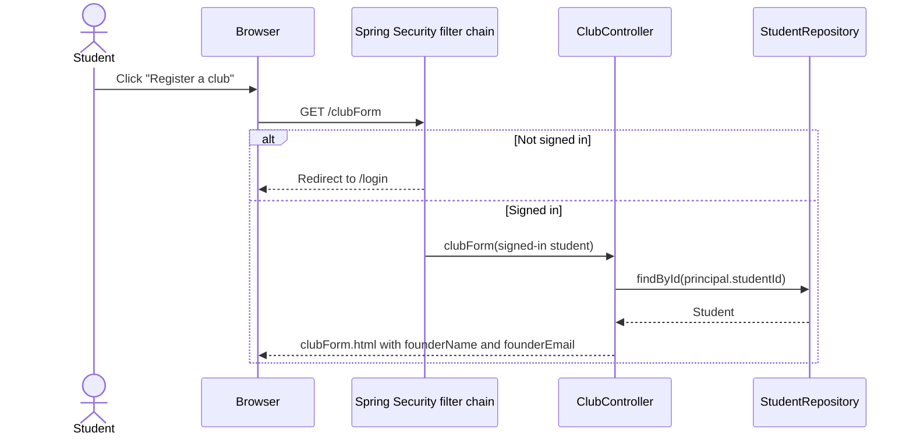
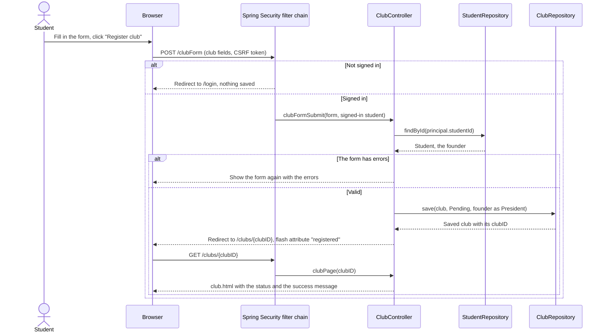
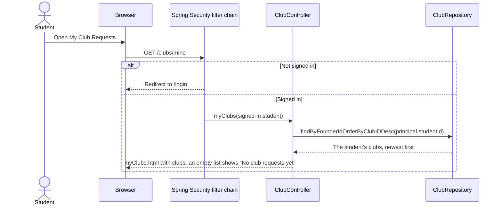
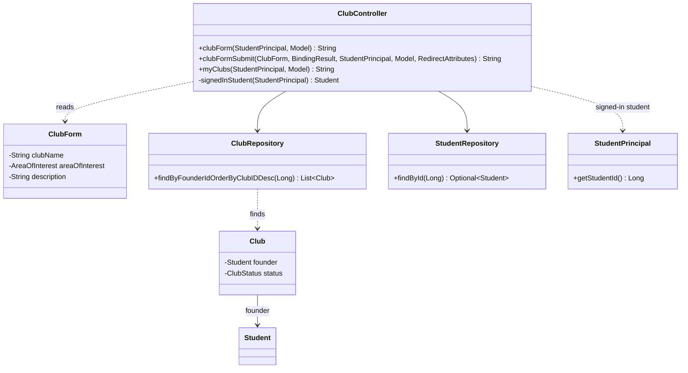

# Feature Design

## Related Requirements
FR-002-01 to FR-002-07, NFR-002-01 and NFR-002-02 (see `requirements.md`)

## UML Diagrams

The diagrams are written in Mermaid, which GitHub draws directly in this file.

### Sequence: opening the registration form

### Sequence: submitting a registration

### Sequence: My Club Requests

### Class diagram: new and changed classes

## Design Notes

- **Main classes or components:**
  - `ClubController` (changed): the registration form, the submission and My Club Requests.
  - `ClubForm` (changed): loses `founderStudentNumber`.
  - `ClubRepository` (changed): finds a student's clubs.
  - `clubForm.html` and `club.html` (changed) and `myClubs.html` (new): plain pages in FR-002.7, styled in FR-002.8 (#58).
- **Responsibilities:**
  - `ClubController.clubForm` loads the signed-in student and adds their name and email to the model for the founding officer fields (FR-002-02).
  - `ClubController.clubFormSubmit` takes the founder from the signed-in student, never from the request (NFR-002-01). It saves the club as Pending with the founder as its President (FR-002-03), adds the `registered` flash attribute and redirects to the club's page, so refreshing that page doesn't submit the form again (FR-002-05). When the form has errors, it shows the form again with the founder fields.
  - `ClubController.signedInStudent` (private) loads the `Student` for the principal's `studentId`. Every method that needs the founder goes through it, so there is one place that decides who the founder is.
  - `ClubController.myClubs` lists the signed-in student's clubs, newest first, as `ClubResponse` objects (FR-002-07, NFR-002-02).
  - `ClubController.clubPage` doesn't change. A flash attribute reaches the model of the page the browser is redirected to, so `club.html` can read `registered` directly.
  - The signed-out scenarios need no new code: `/clubForm` and `/clubs/mine` are not on the public list in `SecurityConfig` (FR-010-05), so Spring Security redirects to `/login` before `ClubController` runs (FR-002-04).
- **Important interactions (fixed names for front-end and test work):**

  | What | Name or URL |
  |---|---|
  | Registration form | `GET /clubForm`, template `clubForm.html`, form object `clubForm` |
  | Founding officer on the form | Model attributes `founderName` (first and last name) and `founderEmail` |
  | Registration submit | `POST /clubForm` with `clubName`, `areaOfInterest` and `description` (FR-002.6 adds its fields); `th:action="@{/clubForm}"` adds the CSRF token |
  | After a successful registration | Redirect to `/clubs/{clubID}`, with the flash attribute `registered` set to `true` for that one page view |
  | Status on the club page | `${club.status.status}`, which is "Pending" for a new club |
  | My Club Requests | `GET /clubs/mine`, template `myClubs.html`, model attribute `clubs`: a list of `ClubResponse`, newest first, empty when there are none |

- **Assumptions:**
  - Every signed-in student has a profile, because sign-in looks the student up by email. If the profile is missing anyway, the request fails with HTTP 403 instead of saving a club without a founder.
  - "Newest first" sorts by `clubID`, which the database assigns in increasing order. FR-002.6 records the submission time, and the order can switch to it then.
  - `/clubs/mine` doesn't clash with `/clubs/{clubID}`: Spring picks an exact path over a pattern, as it already does for `/clubs/search`.
  - Tests that submit the form sign in as a real student with `with(user(new StudentPrincipal(student)))`, because the founder now comes from the principal. `@WithMockUser` has no student behind it.
  - Not in this feature: hiding pending clubs from other students and from search (FR-009.1, #62, Sprint 3, once clubs can be approved), and the meeting info, faculty advisor and contact email fields, duplicate names and invalid categories (FR-002.6, #52).
