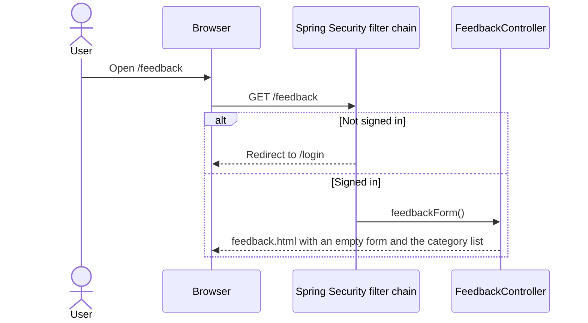
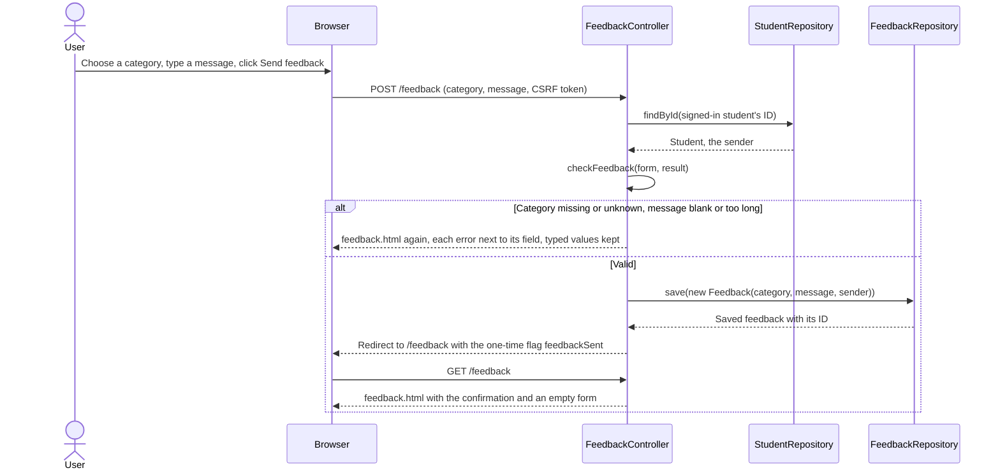
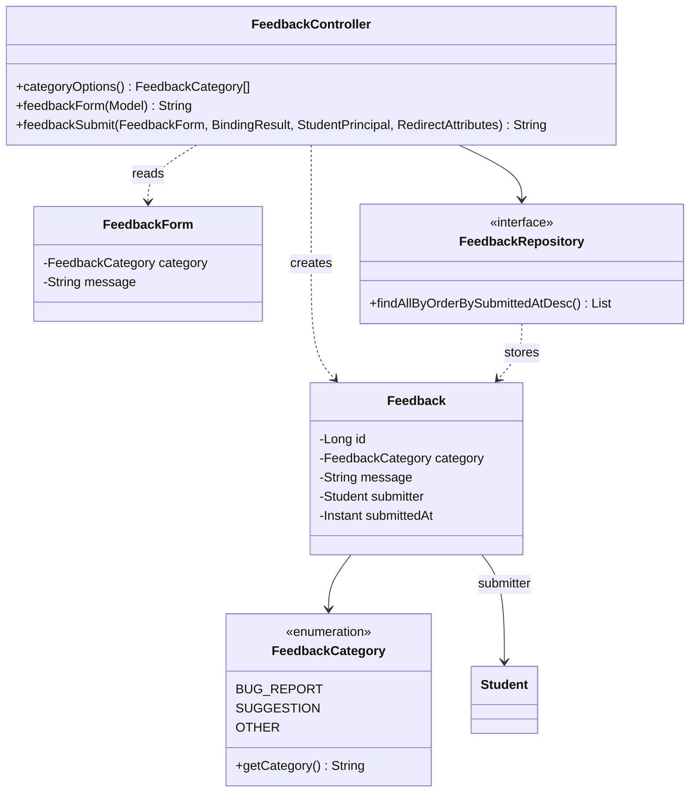

# Feature Design

## Related Requirements
FR-008-01 to FR-008-08, NFR-008-01 to NFR-008-05 (see `requirements.md`)

## UML Diagrams

The diagrams are written in Mermaid, which GitHub draws directly in this file.

### Sequence: opening the feedback form

### Sequence: submitting feedback

### Class diagram: new classes

## Design Notes

- **Main classes or components:**
  - `FeedbackCategory` (new, `entities`): the three categories, each with the name the form shows, like `AreaOfInterest`.
  - `Feedback` (new, `entities`): one stored piece of feedback.
  - `FeedbackForm` (new, `dto`): what the form sends.
  - `FeedbackRepository` (new, `repository`): saves feedback, and lists it newest first for whoever reviews it.
  - `FeedbackController` (new, `controller`): shows the form, checks a submission and stores it.
  - `feedback.html` (new): a plain page from FR-008.1, styled in FR-008.2.
  - `messages.properties` (changed): the message for a category that isn't in the list.
- **Responsibilities:**
  - `FeedbackController.checkFeedback` runs every check on the server (NFR-008-02) and attaches each problem to its own field, the same way `ClubController.checkRegistration` does.
  - The sender always comes from the signed-in student (NFR-008-01). `FeedbackForm` has no sender field, so a value sent with the form has nowhere to go.
  - A category that isn't in the list never reaches `checkFeedback` as a value: Spring records it as a conversion error, and `messages.properties` gives it a friendly message (NFR-008-03).
  - After a successful submission, the controller redirects to `/feedback` with a one-time flag, so refreshing the page can't send the feedback twice (FR-008-03).
- **Important interactions (fixed names for front-end and test work):**

  | What | Name or URL |
  |---|---|
  | Feedback page | `GET /feedback`, template `feedback.html`, title "Send Feedback - ClubHub" |
  | Submitting | `POST /feedback` with fields `category` and `message`; `th:action="@{/feedback}"` adds the CSRF token |
  | Form object | `${feedbackForm}`, bound with `th:object` |
  | Category list | `${categoryOptions}`; submit the name (`BUG_REPORT`), show `${c.category}` ("Bug report") |
  | Field errors | `th:errors="*{category}"` and `th:errors="*{message}"` |
  | Error messages | "Choose a category", "Choose a category from the list", "Enter your feedback", "Keep your feedback to 1000 characters or fewer" |
  | Confirmation | `${feedbackSent}` is true once after a successful submission; text "Thanks, your feedback was received." |
  | Message limit | 1000 characters, `FeedbackController.MAX_MESSAGE_LENGTH` |

- **Assumptions:**
  - `SecurityConfig` already sends signed-out visitors to `/login` for every page that isn't public, so `/feedback` needs no security change (FR-008-07).
  - The message is stored without the spaces around it. Spaces and line breaks inside it are kept.
  - The feedback is stored in the same database as the rest of ClubHub: PostgreSQL locally and once deployed, H2 in the tests.
  - Not in this feature: a page for reviewing feedback (it would need the administrator role from FR-009), replying to feedback, attachments, and anonymous feedback.
