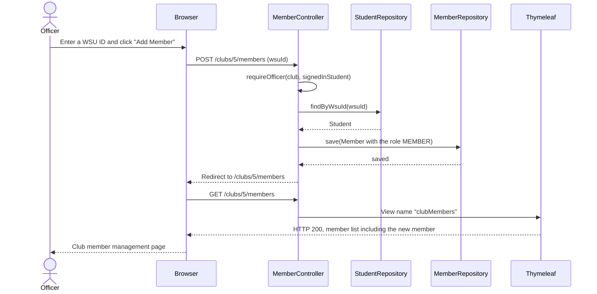
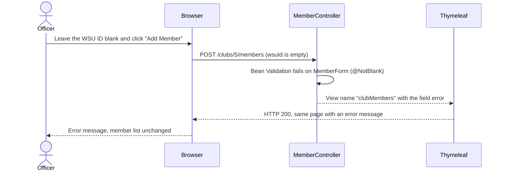
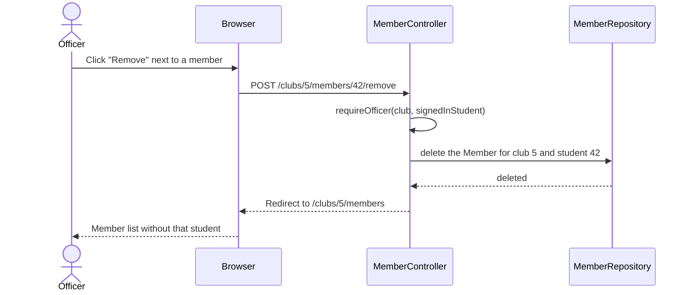
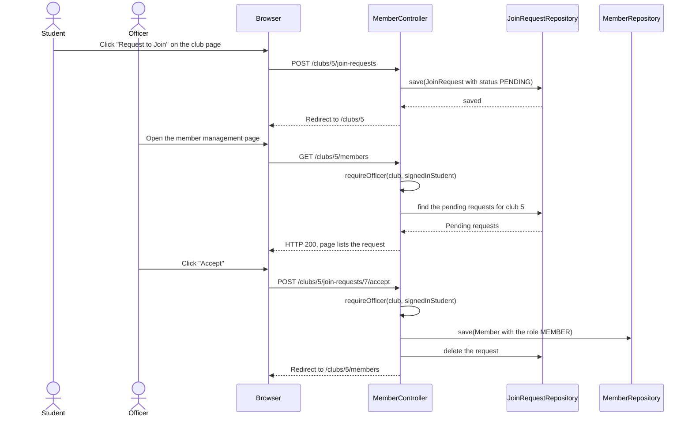
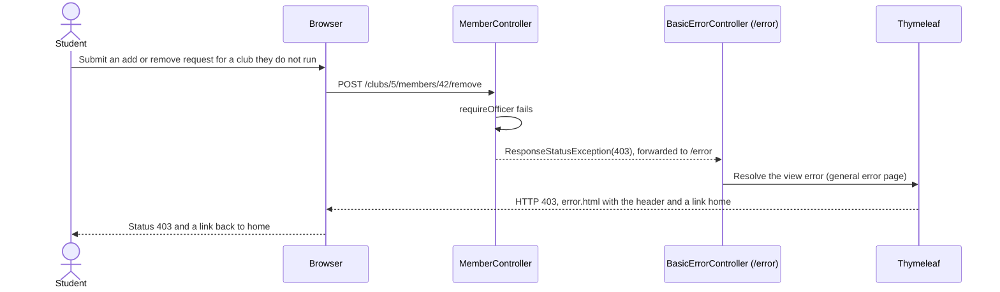
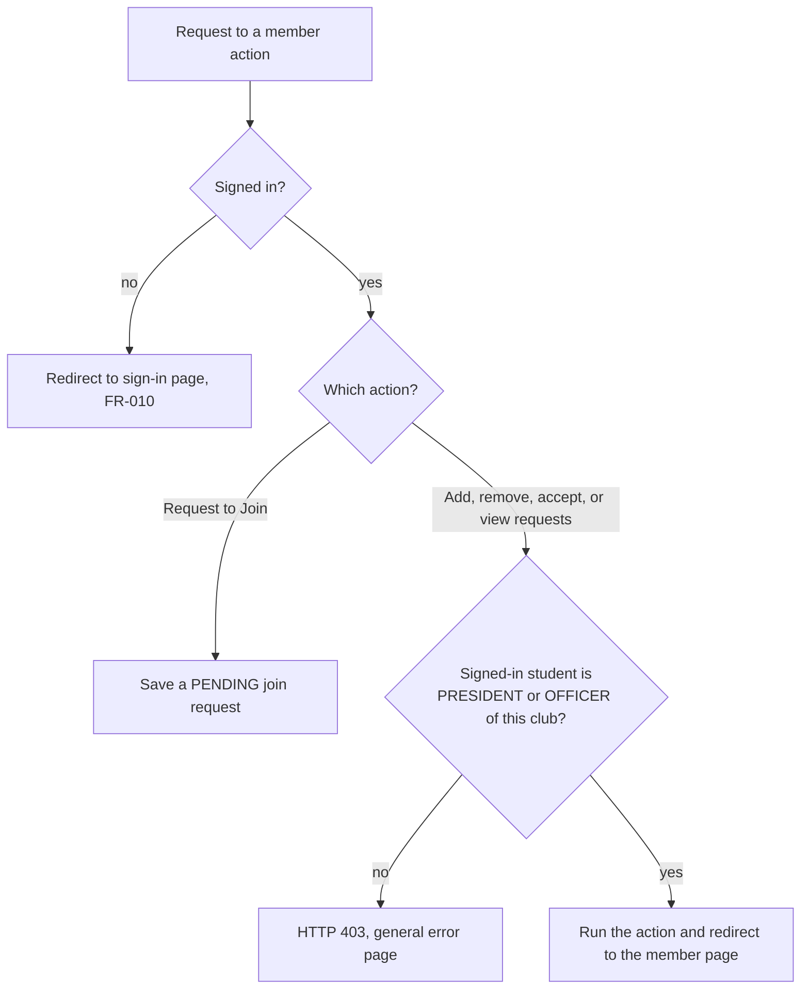
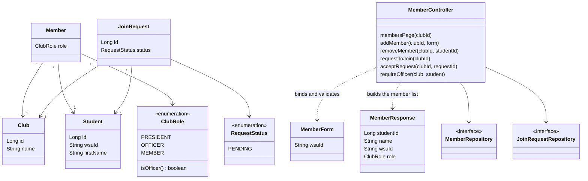

# Feature Design

## Related Requirements
FR-004-01 to FR-004-05, NFR-004-01 to NFR-004-04 (see `requirements.md`)

## UML Diagrams

The diagrams are written in Mermaid, which GitHub draws directly in this file.

### Sequence: adding a member (FR-004-01)

### Sequence: adding a member without required information (FR-004-02)

### Sequence: removing a member (FR-004-03)

### Sequence: requesting to join and accepting the request (FR-004-04)

### Sequence: a non-officer tries to manage members (FR-004-05)

### Activity: who may do what

### Class diagram: domain and web layer

## Design Notes

- **Main classes or components:**
  - `controller/MemberController` (new): maps the member management page and the add, remove, request and accept actions. It holds the officer check.
  - `entities/Member` and `entities/ClubRole` (existing): a student's place in a club and the role. `ClubRole.isOfficer()` is true for `PRESIDENT` and `OFFICER`. The founder is saved as `PRESIDENT` when a club is registered.
  - `entities/JoinRequest` and `entities/RequestStatus` (new): a student's pending request to join a club.
  - `dto/MemberForm` (new): the WSU ID typed by the officer, with `@NotBlank`.
  - `dto/MemberResponse` (changed): one row of the member list. `dto/JoinRequestResponse` (new): one row of the pending requests.
  - `repository/JoinRequestRepository` (new) and `repository/MemberRepository` (new, only if `Member` is its own entity today). If `Member` lives inside `Club`, the controller saves through `ClubRepository` instead.
  - `templates/clubMembers.html` (new): the member management page.
  - `templates/club.html` (changed): the "Request to Join" button and an officer-only "Manage members" link.
  - `controller/ClubController` (changed, if needed): saves the founder as `PRESIDENT` and tells `club.html` whether the signed-in student is an officer, a member or has a pending request.
- **Responsibilities:**
  - `requireOfficer(club, student)` is the only place that decides who may change members or accept requests (NFR-004-01). Every officer-only action calls it first, so no action can skip the check.
  - A refused change throws `ResponseStatusException(403)`, the same way `ClubController` already throws 404, so the general error page from FR-006 (`error.html`) shows it. Nothing is saved or deleted.
  - A blank WSU ID shows an error message on the member page and leaves the list unchanged (FR-004-02).
  - Every successful change redirects to `GET /clubs/{id}/members` (post-redirect-get), so a refresh does not repeat the change.
  - The acting student comes from the sign-in (FR-010.1), never from a form field or URL (NFR-004-02).
- **Important interactions (fixed names for front-end and test work):**

  | What | Name or URL |
  |---|---|
  | Member management page | `GET /clubs/{clubId}/members`, template `clubMembers.html` |
  | Add a member | `POST /clubs/{clubId}/members`, field `wsuId`, button "Add Member" |
  | Remove a member | `POST /clubs/{clubId}/members/{studentId}/remove`, button "Remove" |
  | Request to join | `POST /clubs/{clubId}/join-requests`, button "Request to Join" on `club.html` |
  | Accept a request | `POST /clubs/{clubId}/join-requests/{requestId}/accept`, button "Accept" |
  | Roles | `PRESIDENT`, `OFFICER`, `MEMBER` |
  | Refused change | HTTP 403, `error.html` |
  | Blank WSU ID | HTTP 200, `clubMembers.html` again with the message next to the WSU ID field |

- **Assumptions:**
  - Sign-in (FR-010.1) is merged before this feature, so there is always a signed-in student. A signed-out visitor is sent to the sign-in page first (FR-010-05). Until then the signed-in student is stubbed.
  - `ClubRole` has the values `PRESIDENT`, `OFFICER` and `MEMBER`. Add any that are missing.
  - The only required information for "Add Member" is the WSU ID, and the student must already have a student profile with that WSU ID. A WSU ID that matches no student is reported like a blank one.
  - Until FR-006.1 is merged there is no shared header or `error.html`, so a 403 shows Spring Boot's default error page. Once it is merged, `clubMembers.html` inserts the header like every other page.
  - Every POST form uses `th:action`, so the CSRF token from FR-010 is included.
  - Desktop browsers only; no mobile layout (`mission.md`).
  - Not in this feature: changing a member's role, declining a request, and e-mail notifications.
