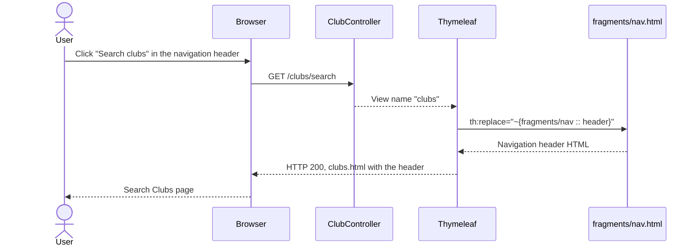
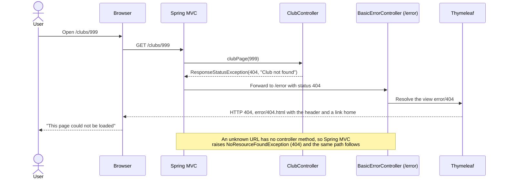
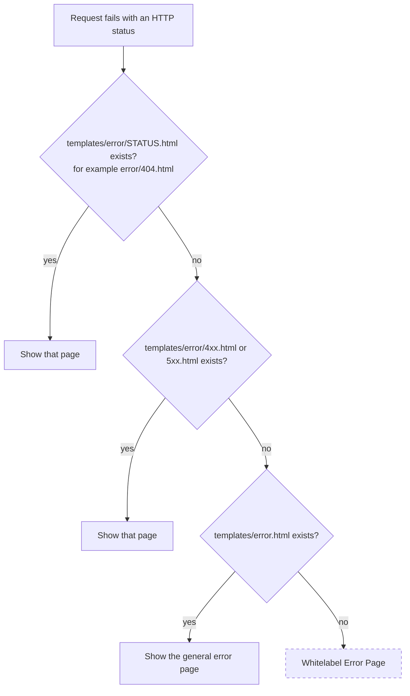
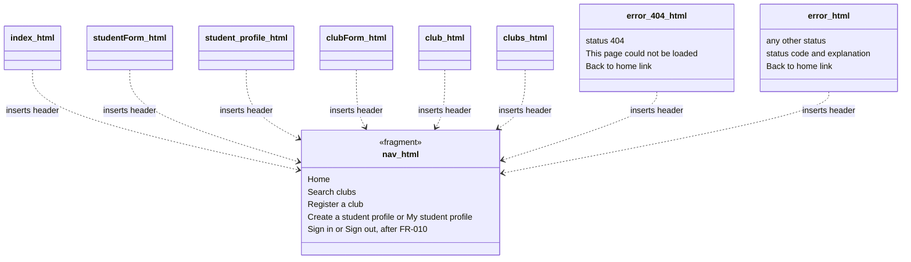

# Feature Design

## Related Requirements
FR-006-01 to FR-006-08, NFR-006-01 to NFR-006-05 (see `requirements.md`)

## UML Diagrams

The diagrams are written in Mermaid, which GitHub draws directly in this file.

### Sequence: following a navigation link

### Sequence: opening a page that can't be loaded

### Activity: how Spring Boot picks the error page

ClubHub provides `error/404.html` and `error.html`, so every status ends at one of those two and the Whitelabel page is never reached (FR-006-05).

### Component diagram: templates and the shared header

`no-profile.html` is left out: once sign-in (FR-010) is merged, `/profile` always has a signed-in student, so that page can't be reached and FR-010 removes it. `login.html` from FR-010.2 also inserts the header once it exists.

## Design Notes

- **Main classes or components:**
  - `templates/fragments/nav.html` (new): the navigation header, written once and inserted into every page. It replaces the empty placeholder `fragments/details.html`.
  - `templates/error/404.html` (changed): the "Page not found" page.
  - `templates/error.html` (new): the general error page for every other status.
  - Every other template (changed): inserts the header and follows the title pattern.
  - `static/styles.css` (changed): styles for the header.
  - No Java changes. `ClubController` and `StudentController` already return 404 for a missing club or student (`HomeController` only maps `/`), and Spring Boot's `BasicErrorController` already renders `error/...` templates.
- **Responsibilities:**
  - `nav.html` holds the only copy of the navigation links (NFR-006-01). Each link uses `th:href="@{...}"`.
  - `error/404.html` covers every "not found" case: unknown URLs and missing clubs or students (FR-006-04).
  - `error.html` covers every other status (FR-006-05). It shows `${status}` and `${error}`, which Spring Boot adds to the model, for example "400" and "Bad Request".
  - Both error pages show the header and a "Back to home" link (FR-006-06), so the user can always leave.
  - Normal pages rely on the header's "Home" link, so their own "Back to home" links are removed. Only the two error pages keep a separate "Back to home" link, because a user who lands on an error page needs the way out to be obvious.
- **Important interactions (fixed names for front-end and test work):**

  | What | Name or URL |
  |---|---|
  | Header fragment | `templates/fragments/nav.html`, fragment name `header` |
  | Inserting it | `<header th:replace="~{fragments/nav :: header}"></header>` as the first element in `<body>` |
  | Links shown to everyone | "Home" `/`, "Search clubs" `/clubs/search`, "Register a club" `/clubForm` |
  | Links before FR-010 | "Create a student profile" `/studentForm`, "My student profile" `/profile` |
  | Signed-out links (after FR-010) | "Create a student profile" `/studentForm` and "Sign in" `/login`, inside `sec:authorize="isAnonymous()"` |
  | Signed-in links (after FR-010) | "My student profile" `/profile`, the first name and the "Sign out" button, inside `sec:authorize="isAuthenticated()"` (FR-010-11) |
  | Not-found page | `templates/error/404.html`, HTTP 404, text "This page could not be loaded" |
  | General error page | `templates/error.html`, the original HTTP status, shows `${status}` and `${error}` |
  | Link home on error pages | `<a th:href="@{/}">Back to home</a>` |
  | Page titles | "Page name - ClubHub"; the home page is "ClubHub" |

- **Assumptions:**
  - Spring Boot's defaults stay as they are: `server.error.include-stacktrace=never`, `server.error.include-message=never` and `server.error.include-exception=false`. They are what keep technical details off the error pages (NFR-006-03), so nobody should turn them on.
  - The "unavailable directory" in the Gherkin scenario means any page that can't be loaded: a mistyped or outdated URL, a club or student that doesn't exist, or a request the server can't handle.
  - Sign-in (FR-010) owns the signed-in parts of the header: the first name, the sign-out button and the "Sign in" link (FR-010-11, FR-006-08). Whichever feature merges first creates `nav.html`, and the other adds to it. Until FR-010 is merged, the header has no "Sign in" link, because `/login` doesn't exist yet and the link would lead to the 404 page, and it uses no `sec:` attributes.
  - Once FR-010 is merged, `/error` stays public (FR-010-05). That lets the error page itself render for any visitor, for example a 403 from a missing CSRF token lands on `error.html`. But a signed-out visitor who opens a protected or unknown URL, such as `/clubs/999`, is sent to the sign-in page first, so only a signed-in student sees the 404 or 400 page for those URLs.
  - Desktop browsers only; no mobile layout (`mission.md`).
  - Not in this feature: a highlighted "current page" in the header, breadcrumbs, and a site-wide search box.
