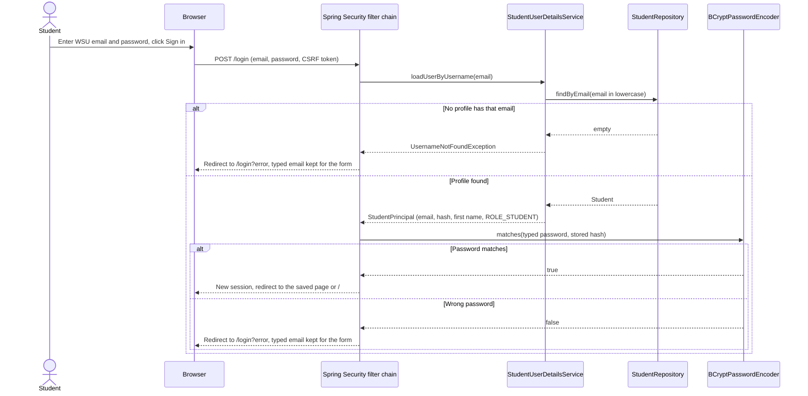
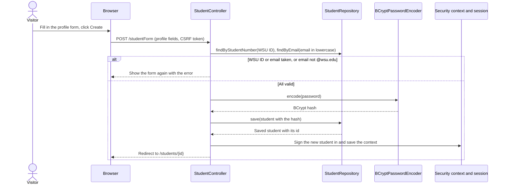
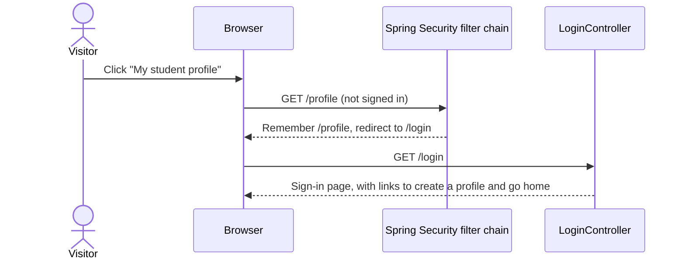
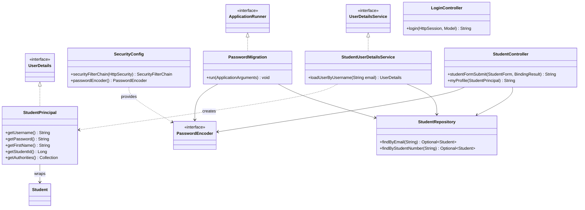

# Feature Design

## Related Requirements
FR-010-01 to FR-010-11, NFR-010-01 to NFR-010-05 (see `requirements.md`)

## UML Diagrams

The diagrams are written in Mermaid, which GitHub draws directly in this file.

### Sequence: signing in

### Sequence: creating a profile and signing in

### Sequence: signed-out visitor opens a protected page

### Class diagram: new and changed classes

## Design Notes

- **Main classes or components:**
  - `SecurityConfig` (new): the sign-in rules and the BCrypt `PasswordEncoder`.
  - `StudentUserDetailsService` and `StudentPrincipal` (new): find a student by email and describe them to Spring Security.
  - `LoginController` (new): shows the sign-in page.
  - `PasswordMigration` (new): hashes old plain-text passwords at startup.
  - `StudentController`, `StudentRepository` and `Student` (changed).
  - `login.html` (new): a plain page in FR-010.1, styled in FR-010.2.
  - The shared header (changed, FR-010.2).
- **Responsibilities:**
  - `SecurityConfig` lists the public pages (FR-010-05), sets up sign-in at `/login` with the `email` and `password` fields, and sends sign-out to `/`.
  - `StudentUserDetailsService` looks the student up by lowercase email. It throws `UsernameNotFoundException` when there is no match, which Spring shows as the same error as a wrong password (NFR-010-02).
  - `StudentPrincipal` carries the email, password hash, first name, student ID and `ROLE_STUDENT`. FR-009 adds more roles later.
  - `StudentController` checks the WSU ID and the email (`@wsu.edu`, unique), hashes the password, saves the student and signs them in. `/profile` uses the signed-in student, which replaces the `studentId` session workaround.
  - `PasswordMigration` runs once at each startup and hashes every stored password that doesn't start with a BCrypt prefix (`$2a$`, `$2b$` or `$2y$`). Running it again changes nothing.
- **Important interactions (fixed names for front-end and test work):**

  | What | Name or URL |
  |---|---|
  | Sign-in page | `GET /login`, template `login.html` |
  | Sign-in form | `POST /login` with fields `email` and `password`; `th:action="@{/login}"` adds the CSRF token |
  | Failed sign-in | Redirect to `/login?error`; the page reads `${param.error}` and the model attribute `email` |
  | Successful sign-in | The saved page, otherwise `/` |
  | Sign-out | A form with a button that posts to `/logout`, then `/` |
  | Name in the header | `sec:authentication="principal.firstName"` |
  | Signed in or not | `sec:authorize="isAuthenticated()"` and `sec:authorize="isAnonymous()"` |
  | Role | `ROLE_STUDENT` for every signed-in student |

  The typed email after a failed sign-in is kept in the session, not in the URL, and `LoginController` moves it into the model attribute `email`.
- **Assumptions:**
  - Real WSU single sign-on is out of scope (`mission.md`).
  - The `sec:` attributes come from `thymeleaf-extras-springsecurity6`.
  - Sign-out must be a POST, so it is a button in a form, not a plain link.
  - Signing a student in after profile creation must save the security context to the session explicitly and change the session ID. Spring Security 6 doesn't save it automatically when you sign someone in yourself.
  - Tests keep running on H2. POST requests in tests need `.with(csrf())`, and protected pages need a signed-in test user.
  - Not in this feature: "remember me", password reset, account lockout and email verification.
